# Dual-Agent Parallel Execution Plan & Wave Roadmap
**Project:** `SaaS_Learning_Exit_Exam_Platform`  
**Target Environment:** Supabase (`sbvyjbipchglzmttkowy` in `eu-west-1`) • Fedora Host (8GB RAM)  
**Agent Architecture:** Dual-Agent Concurrent Tracks with Zero-Conflict Directory Isolation

---

## 1. Master Parallel Execution Matrix

| Wave | Track A: GitHub Copilot Agent (`backend/`, `supabase/`, `web/`) | Track B: Antigravity CLI `agy` (`mobile/`) | Safe Boundary | Convergence & Verification Gate |
| :--- | :--- | :--- | :--- | :--- |
| **Wave 1** *(Now)* | **Day 2**: `backend/scripts/apply_migrations.py`, `supabase/migrations/` $\rightarrow$ **Day 3**: `backend/app/identity/`, `backend/app/tenants/`, RLS middleware | **Day 4**: `mobile/src/shared/` (Theme tokens, Keychain/Keystore) $\rightarrow$ **Day 5**: `mobile/src/shared/database/` (13-table SQLCipher schema) | `backend/` & `supabase/` vs. `mobile/` | `pytest backend/tests/test_slice1_auth_and_rls.py` + SQLCipher unit test on device |
| **Wave 2** | **Day 8**: `backend/app/content/`, `backend/app/entitlements/` (`/api/v1/resources/*`, `StorageAdapter`, download grants) | **Day 6**: `mobile/src/features/auth/` (`MOB-01`..`MOB-04` AuthStack & Biometrics) | `backend/` vs. `mobile/` | Backend grant issue + Mobile offline biometrics unlock verified |
| **Wave 3** | **Day 12**: `backend/app/assessments/`, `backend/app/learning/` (`/api/v1/exams/*`, immutable snapshots, `grade_exam_attempt()`) | **Day 9 $\rightarrow$ Day 10 $\rightarrow$ Day 11**: `mobile/src/services/download-manager/`, `MOB-09`..`MOB-12` (Downloads & Reader) | `backend/` vs. `mobile/` | Server assessment contract ready; mobile downloads encrypted PDF and verifies SHA-256 |
| **Wave 4** | **Day 15**: `backend/app/mobile_sync/` (`/api/v1/sync/pull`, `push`, `status`, `sync_changes` ledger) | **Day 13 $\rightarrow$ Day 14**: `mobile/src/features/exams/` (`MOB-13`..`MOB-16`, `MOB-18`..`MOB-20` Exam Runner & Palette) | `backend/` vs. `mobile/` | Mobile commits offline answers in <16ms; backend sync endpoints accept monotonic cursors |
| **Wave 5** | **Day 19**: `backend/app/analytics/` (`/api/v1/me/progress`) $\rightarrow$ **Day 20**: `backend/app/ai/` (PDF ingestion + `pgvector(384)` AI Tutor) | **Day 16**: `mobile/src/services/sync-engine/` + `MOB-17` $\rightarrow$ **Day 17**: `mobile/src/features/sync/MOB-28` (Sync Center) | `backend/` vs. `mobile/` | Airplane-mode submission queues locally, syncs idempotently via UUID `operation_id` |
| **Wave 6** | **Day 21**: `backend/app/analytics/` (DuckDB + Parquet Lake Mirror) $\rightarrow$ **Day 22**: `backend/app/commerce/` (`/products`, `/orders`, webhooks) | **Day 19**: `mobile/src/features/analytics/MOB-21`..`MOB-22` $\rightarrow$ **Day 20**: `mobile/src/features/ai/AiTutorSheet` | `backend/` vs. `mobile/` | Progress screen renders mastery; mobile AI Tutor queries vector search with citations |
| **Wave 7** | **Day 24**: `web/` Public Portal & Instructor Authoring $\rightarrow$ **Day 25**: `web/` Institutional Admin Cohort Dashboard & Lake Explorer | **Day 23**: `mobile/src/features/commerce/MOB-24`..`MOB-26` $\rightarrow$ **Day 26**: `mobile/src/features/profile/MOB-23`, `27`, `29`, `30` | `web/` vs. `mobile/` | Web admin allocates seats; mobile initiates payment and manages offline storage limits |
| **Wave 8** | **Day 27**: Full-system cross-tenant RLS regression suite & 60fps Samsung Galaxy A04s/A05s memory profiling | **Day 28**: Release packaging (`v1.0.0-pilot` Android APK/AAB), Supabase PITR verification, and smoke tests | Unified Monorepo Validation | Zero unsynced queue loss on logout; pilot APK ready for deployment |

---

## 2. Visual Architecture & Swimlane Concurrency

```mermaid
flowchart TD
    subgraph Wave1["Wave 1: Foundation & Schemas"]
        direction LR
        W1_TrackA["Track A: Copilot Agent<br>• Day 2: Apply Migrations & Seed DB<br>• Day 3: FastAPI Auth & RLS Middleware"]
        W1_TrackB["Track B: Antigravity CLI agy<br>• Day 4: Mobile Design System & Keychain<br>• Day 5: 13-Table SQLCipher Spike"]
    end

    subgraph Wave2["Wave 2: Content Delivery & Auth Screens"]
        direction LR
        W2_TrackA["Track A: Copilot Agent<br>• Day 8: StorageAdapter & Download Grants"]
        W2_TrackB["Track B: Antigravity CLI agy<br>• Day 6: MOB-01..04 AuthStack & Biometrics"]
    end

    subgraph Wave3["Wave 3: Assessment Engine & Download Services"]
        direction LR
        W3_TrackA["Track A: Copilot Agent<br>• Day 12: Exam Snapshots & Server Grading"]
        W3_TrackB["Track B: Antigravity CLI agy<br>• Days 9-11: Resumable Downloader & Reader MOB-09..12"]
    end

    subgraph Wave4["Wave 4: Sync Protocol & Exam Runner"]
        direction LR
        W4_TrackA["Track A: Copilot Agent<br>• Day 15: Opaque Sync Ledger & /sync/*"]
        W4_TrackB["Track B: Antigravity CLI agy<br>• Days 13-14: MOB-13..20 Locked Exam Runner"]
    end

    subgraph Wave5["Wave 5: Analytics/AI Backend & Mobile Sync Center"]
        direction LR
        W5_TrackA["Track A: Copilot Agent<br>• Day 19: /me/progress Analytics<br>• Day 20: PDF Ingestion + pgvector AI"]
        W5_TrackB["Track B: Antigravity CLI agy<br>• Day 16: Mobile SyncEngine & MOB-17<br>• Day 17: MOB-28 Sync Center UI"]
    end

    subgraph Wave6["Wave 6: Data Lake/Commerce & Mobile UI Integrations"]
        direction LR
        W6_TrackA["Track A: Copilot Agent<br>• Day 21: DuckDB/Parquet Lake Mirror<br>• Day 22: Commerce & Webhook Adapters"]
        W6_TrackB["Track B: Antigravity CLI agy<br>• Day 19: MOB-21..22 Mastery Progress<br>• Day 20: Grounded AI Tutor Sheet"]
    end

    subgraph Wave7["Wave 7: Web Portals & Mobile Finalization"]
        direction LR
        W7_TrackA["Track A: Copilot Agent<br>• Day 24: web/ Public & Instructor Portal<br>• Day 25: web/ Institution Admin Dashboard"]
        W7_TrackB["Track B: Antigravity CLI agy<br>• Day 23: MOB-24..26 Store & Checkout<br>• Day 26: MOB-23, 27, 29, 30 Profile & Security"]
    end

    subgraph Wave8["Wave 8: Release Gate & Production Hardening"]
        W8_Gate["Days 27-28: Performance Profiling • Security RLS Audit • v1.0.0-pilot Packaging"]
    end

    Wave1 --> Wave2
    Wave2 --> Wave3
    Wave3 --> Wave4
    Wave4 --> Wave5
    Wave5 --> Wave6
    Wave6 --> Wave7
    Wave7 --> Wave8
```

---

## 3. Wave-by-Wave Execution Directives

### Wave 1 (Active Now) — Backend Core & Mobile SQLite Foundation
* **Safe Boundary:** `backend/` & `supabase/` vs. `mobile/`
* **Track A — GitHub Copilot Agent (`backend/` & `supabase/`):**
  * **Day 2**: Complete `backend/scripts/apply_migrations.py` to idempotently run `supabase/migrations/20261114000001_init_reconciled_schema.sql` and `20261114000002_seed_curriculum.sql` against Supabase Cloud (`sbvyjbipchglzmttkowy`).
  * **Day 3**: Build FastAPI auth endpoints in `backend/app/identity/` and `backend/app/tenants/` (`/register`, `/login`, `/refresh`, `/logout`, `/me/workspaces`), plus async RLS session middleware setting `app.current_user_id` and `app.current_tenant_id`.
  * *Verification Command:* `pytest backend/tests/test_slice1_auth_and_rls.py -v`
* **Track B — Antigravity CLI `agy` (`mobile/`):**
  * **Day 4**: Scaffold React Native TypeScript architecture (`mobile/src/`), theme tokens (WCAG AA Light/Dark), and Keychain/Keystore secure storage adapter.
  * **Day 5**: Implement 13-table SQLite/SQLCipher database schema in `mobile/src/shared/database/` (`local_themes` through `device_profile`) and run Android validation spike via `scrcpy`/USB.
  * *Verification Command:* Run SQLite migration test verifying all 13 tables initialize in `<100ms`.

---

### Wave 2 — Protected Content Engine & Mobile Authentication UX
* **Safe Boundary:** `backend/app/content/`, `entitlements/` vs. `mobile/src/features/auth/`
* **Track A — GitHub Copilot Agent (`backend/`):**
  * **Day 8**: Implement `evaluate_resource_access` in `backend/app/entitlements/service.py` and upgrade `backend/app/content/storage_adapter.py` to support byte-range streaming (`206 Partial Content`) and signed download grants (`POST /api/v1/resources/{id}/download-grant`).
  * *Verification Command:* `pytest backend/tests/test_slice3_content_and_storage.py -v`
* **Track B — Antigravity CLI `agy` (`mobile/`):**
  * **Day 6**: Build `AuthStack` covering `MOB-01` (Welcome), `MOB-02` (SignIn with Offline Biometric Unlock), `MOB-03` (CreateAccount), and `MOB-04` (WorkspaceSelection). Store refresh token in secure storage; zero secrets in `AsyncStorage`.
  * *Verification Command:* Verify offline biometric unlock card launches and navigates with mocked session.

---

### Wave 3 — Assessment Core & Protected Document Reader
* **Safe Boundary:** `backend/app/assessments/`, `learning/` vs. `mobile/src/features/resources/`
* **Track A — GitHub Copilot Agent (`backend/`):**
  * **Day 12**: Implement `GET /api/v1/exams`, `POST /api/v1/exams/{id}/attempts` (storing immutable `question_snapshots` stripped of `is_correct`), `POST /api/v1/attempts/{id}/answers`, and `POST /api/v1/attempts/{id}/submit` invoking PostgreSQL function `public.grade_exam_attempt()`.
  * *Verification Command:* `pytest backend/tests/test_slice4_assessments.py -v`
* **Track B — Antigravity CLI `agy` (`mobile/`):**
  * **Days 9–11**: Build `mobile/src/services/download-manager/` (resumable chunked downloads + SHA-256 integrity verifier) and screens `MOB-09` (ResourceLibrary), `MOB-10` (ResourceDetail), `MOB-11` (ProtectedContentReader with `<WatermarkOverlay />` and Android `FLAG_SECURE`), and `MOB-12` (DownloadManager).
  * *Verification Command:* Verify encrypted file download, SHA-256 check, and watermark rendering.

---

### Wave 4 — Bidirectional Sync Engine & Locked Exam Runner
* **Safe Boundary:** `backend/app/mobile_sync/` vs. `mobile/src/features/exams/`
* **Track A — GitHub Copilot Agent (`backend/`):**
  * **Day 15**: Implement `sync_changes` ledger triggers and sync endpoints: `GET /api/v1/sync/pull` (monotonic sequence cursor + `TOMBSTONE`), `POST /api/v1/sync/push` (UUID `operation_id` idempotency), and `GET /api/v1/sync/status`.
  * *Verification Command:* `pytest backend/tests/test_slice5_sync_engine.py -v`
* **Track B — Antigravity CLI `agy` (`mobile/`):**
  * **Days 13–14**: Build `ExamSessionStack` screens `MOB-13` (PracticeCatalog), `MOB-14` (Instructions), `MOB-15` (Locked Exam Runner with `<16ms` transactional writes to `local_answer_events` and 120-Q `<QuestionPaletteSheet />`), `MOB-16` (SubmitConfirmation), and `MOB-18`..`MOB-20` (Results, Review, History).
  * *Verification Command:* Kill app mid-exam at Question 12; verify instant restore with exact timer and selections.

---

### Wave 5 — Analytics/Vector Backend & Mobile Sync Center UI
* **Safe Boundary:** `backend/app/ai/`, `analytics/` vs. `mobile/src/features/sync/`
* **Track A — GitHub Copilot Agent (`backend/`):**
  * **Day 19**: Implement `GET /api/v1/me/progress` computing Theme & Bloom's mastery vectors.
  * **Day 20**: Implement PDF chunk ingestion script (`backend/scripts/ingest_course_chunks.py`) and vector search tutor endpoint `POST /api/v1/ai/tutor/messages` using `all-MiniLM-L6-v2` (`pgvector(384)`).
  * *Verification Command:* Query tutor endpoint and verify top-3 source chunk citations with cosine distance.
* **Track B — Antigravity CLI `agy` (`mobile/`):**
  * **Day 16**: Implement `SyncEngineService` (pull cursor commit + push queue retry) and `MOB-17` (SubmissionStatus 6-step tracker).
  * **Day 17**: Build `MOB-28` (`SyncCenterScreen.tsx`) with dynamic health badge, manual sync CTA, and 3 segmented queues (Pending, Needs Attention/Rejected, Synced History).
  * *Verification Command:* Test Airplane-Mode transition: queue offline exam, reconnect, and verify automated sync.

---

### Wave 6 — Data Lake/Billing Backend & Mobile Intelligence UX
* **Safe Boundary:** `backend/app/commerce/`, `analytics/lake/` vs. `mobile/src/features/`
* **Track A — GitHub Copilot Agent (`backend/`):**
  * **Day 21**: Build DuckDB + Parquet data lake mirroring script (`backend/scripts/mirror_data_lake.py`) with `snapshot_id` watermarking.
  * **Day 22**: Build commerce endpoints (`/products`, `/orders`, `/checkout-sessions`, `/webhooks/{provider}`) supporting Chapa, Telebirr, Stripe, and Sandbox with HMAC signature verification.
  * *Verification Command:* Simulate signed webhook; verify `payment_events` idempotency and entitlement activation.
* **Track B — Antigravity CLI `agy` (`mobile/`):**
  * **Day 19**: Implement `MOB-21` (ProgressOverview) and `MOB-22` (CourseProgress) with radar mastery visualizations.
  * **Day 20**: Build `AiTutorSheet.tsx` bottom sheet modal connected to vector search with citation cards.
  * *Verification Command:* Open tutor bottom sheet; ask question; verify cited textbook chunk expands cleanly.

---

### Wave 7 — Next.js Admin Portals & Mobile Final Polish
* **Safe Boundary:** `web/` vs. `mobile/src/features/commerce/`, `profile/`
* **Track A — GitHub Copilot Agent (`web/`):**
  * **Day 24**: Build Next.js 14 App Router portal for Public landing and Instructor authoring (markdown/LaTeX question editor & PDF package uploader).
  * **Day 25**: Build Institution Admin seat management dashboard, invitation sender, and Data Lake cohort mastery explorer.
  * *Verification Command:* Run Next.js production build (`npm run build`) in `web/` without type or lint errors.
* **Track B — Antigravity CLI `agy` (`mobile/`):**
  * **Day 23**: Build `MOB-24` (PlansAndAccess), `MOB-25` (Store), and `MOB-26` (CheckoutStatus polling).
  * **Day 26**: Build `MOB-23` (ProfileHome with unsynced-queue logout warning), `MOB-27` (StorageSettings), `MOB-29` (DevicesAndSecurity), and `MOB-30` (Notifications, Language & Offline Help).
  * *Verification Command:* Trigger logout with unsynced operations in queue; verify warning dialog blocks data loss.

---

### Wave 8 — Quality Gate, Security Audit & Pilot Launch
* **Safe Boundary:** Unified Monorepo Integration
* **Joint Deliverables (`Day 27` & `Day 28`):**
  1. **RLS & Security Regression:** Execute cross-tenant penetration test suite ensuring strict tenant isolation across all 15 modules.
  2. **Device Performance Profiling:** Profile Android runtime on target low-tier devices (Samsung Galaxy A04s/A05s) ensuring consistent 60fps and `<150MB` RAM consumption.
  3. **Release Packaging:** Produce `v1.0.0-pilot` APK/AAB bundle, verify Supabase PITR backups, and finalize developer operational runbooks.

---

## 4. Operational Rules for Concurrent Execution

1. **Strict Directory Invariants (Zero Git Conflicts):**
   * GitHub Copilot Agent **MUST NEVER** modify files inside `mobile/`.
   * Antigravity CLI `agy` **MUST NEVER** modify files inside `backend/`, `supabase/`, or `web/`.
   * Interface contract changes (such as API payloads in `docs/`) require mutual alignment before altering client or server code.
2. **Supabase Nano Tier Discipline:**
   * Maximum 60 direct pooler connections. All backend workers must connect via Transaction Pooler port `6543` with `statement_cache_size=0`.
   * Migrations run strictly through Session Pooler port `5432` via `backend/scripts/apply_migrations.py`.
3. **8GB RAM Host Protection:**
   * Run only a single active backend process and mobile Metro bundler at any given time.
   * Avoid running local multi-container Supabase Docker stacks; rely on live Supabase Cloud project `sbvyjbipchglzmttkowy` or the lightweight single `pgvector` container on port `54322`.
